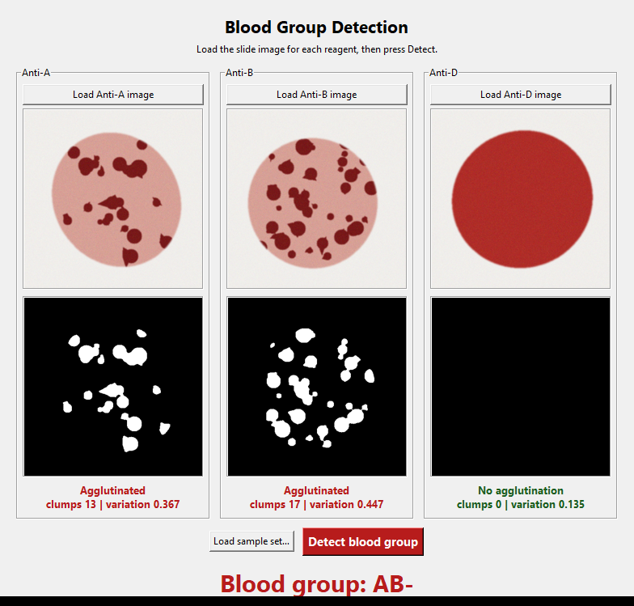
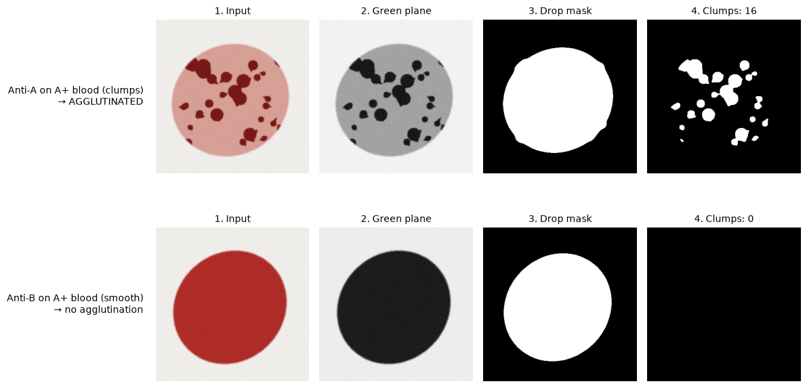

# Blood Group Detection using Image Segmentation

A desktop app that reads images of a blood-slide test and works out the blood group (**A, B, AB, O** with **Rh +/−**) by detecting **agglutination** (clumping) with classical image processing in **OpenCV**.



## The idea

In the slide test, three drops of the same blood are mixed with three reagents. A drop **clumps** when the blood carries the matching antigen:

| Reagent | Clumps if the blood has… |
|---|---|
| Anti-A | A antigen |
| Anti-B | B antigen |
| Anti-D | Rh (D) antigen, i.e. Rh positive |

| Anti-A | Anti-B | ABO group |
|:---:|:---:|:---:|
| ✔ | ✘ | A |
| ✘ | ✔ | B |
| ✔ | ✔ | AB |
| ✘ | ✘ | O |

Anti-D adds **+** (clumps) or **−** (no clumps). Reading the clumps by eye is slow and subjective, so this project automates it.

## How it works



For each of the three images ([`src/detector.py`](src/detector.py)):

1. **Green-plane extraction.** Red cells absorb green light, so in the green channel the cells are dark and the background is bright: the best contrast of the three colour channels.
2. **Drop segmentation.** Gaussian blur + Otsu threshold, then keep the largest connected region (the drop) and erode it slightly so its rim is ignored.
3. **Clump segmentation.** A second Otsu threshold, computed only on pixels inside the drop, separates dark clumps from the pale liquid between them.
4. **Morphological operations.** *Opening* removes speckle noise; *closing* joins broken parts of the same clump.
5. **Connected-component analysis.** Count clumps above a minimum area and measure the brightness variation (std / mean) inside the drop.
6. **Rule-based decision.** A drop is *agglutinated* when it has at least 4 clumps **and** a brightness variation of at least 0.24. The three answers are mapped to the blood group with the table above.

On the sample images the two kinds of drop are far apart, which is why the rule is reliable:

| Drop | Clumps found | Brightness variation |
|---|---|---|
| Agglutinated | 9 – 22 | 0.35 – 0.51 |
| Smooth | 0 | 0.13 – 0.14 |

All thresholds are in one `Thresholds` dataclass, so they can be re-tuned for a different camera or lighting.

## Run it

```bash
python -m venv .venv
.venv\Scripts\activate          # Windows  (Linux/macOS: source .venv/bin/activate)
pip install -r requirements.txt

python app.py                   # desktop app
python -m pytest -q             # 13 tests
```

In the app, either load your own three images, or press **Load sample set…** and pick a folder in `samples/` (for example `samples/AB_neg`), then press **Detect blood group**.

## Sample images

`samples/` holds one set per blood group (8 sets × 3 images). They are **synthetic**: made by [`src/generate_samples.py`](src/generate_samples.py) to imitate real slides (a smooth red drop versus dark clumps in pale liquid), so the app can be tried without a lab. Re-create them with `python -m src.generate_samples`. Real photographs may need the thresholds re-tuned for their lighting.

## Project structure

```
app.py                  Tkinter desktop app
src/detector.py         image pipeline + blood-group rules
src/generate_samples.py synthetic slide images
samples/                8 blood groups × (anti_a, anti_b, anti_d).png
tests/                  pytest: rules, clumped vs smooth, all 8 groups end to end
docs/                   README images (python docs/make_figures.py)
```

## Tech

Python · OpenCV · NumPy · Tkinter · Pillow · pytest

> Educational project. Not a medical device: never use it to make clinical decisions.
